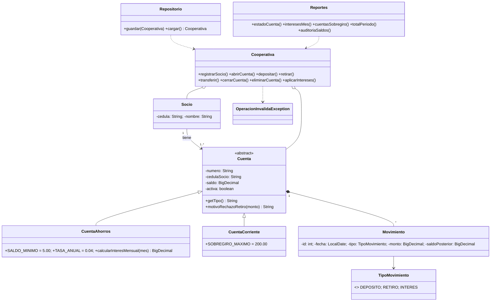

# Cooperativa de Ahorro y Crédito de Imbabura — Trabajo 1 (Ejercicio 2)

Aplicación de consola en **Java (POO)** que guarda la información en archivos **CSV**.
Requiere JDK 11 o superior (probado con JDK 21).

## Compilar y ejecutar

```bash
# Compilar (desde la raíz del repositorio)
javac -encoding UTF-8 -d out src/coop/*.java

# Ejecutar el programa (usa la carpeta ./datos)
java -Dfile.encoding=UTF-8 -cp out coop.Main

# Regenerar los datos de prueba (consistentes entre sí)
java -cp out coop.GeneradorDatos

# Ejecutar los 27 casos de prueba automáticos
java -Dfile.encoding=UTF-8 -cp out coop.Pruebas
```

> En Windows, si ves caracteres raros en la consola, ejecuta antes `chcp 65001`.

## Archivos de datos (`datos/`)

| Archivo | Columnas (separador `;`) |
|---|---|
| `socios.csv` | cedula;nombre |
| `cuentas.csv` | numero;cedula;tipo;saldo;activa |
| `movimientos.csv` | id;cuenta;fecha;tipo;monto;saldoPosterior;descripcion |

## Reglas implementadas

- Depósitos y retiros deben ser > 0.
- **Ahorros:** interés 4 % anual, calculado mensualmente (saldo al cierre del mes × 4 % / 12); saldo mínimo $5.
- **Corriente:** sin intereses; sobregiro hasta $200.
- **Transferencia atómica:** se validan origen, destino y monto antes de aplicar; si algo falla no cambia ninguna cuenta. No se transfiere a la misma cuenta ni a/desde cuentas inactivas.
- No se cierra una cuenta con saldo ≠ 0; una cuenta con movimientos no se elimina, se marca **inactiva**.

### Decisiones de interpretación (documentadas)
1. En ahorros se permite un retiro que deje saldo **exactamente $0** (retiro total) para poder cerrar la cuenta, porque el cierre exige saldo cero.
2. El interés se acredita como un movimiento tipo `INTERES` el último día del mes, y no se acredita dos veces en el mismo mes.
3. Una cuenta de ahorros se abre con al menos $5.
4. Las transferencias pueden hacerse entre cuentas de cualquier socio, mientras sean distintas y estén activas.

## Reportes
1. Estado de cuenta con saldo después de cada movimiento
2. Intereses del mes de las cuentas de ahorro
3. Cuentas en sobregiro
4. Total depositado y retirado en un período
5. Auditoría de saldos (recalcula cada saldo desde los movimientos y revisa las reglas)

## Diagrama de clases



## Integrantes
_(Melody Criollo, Steven Reyna, Villy Reyes, Alexis Pozo, Alexander Vargas)_
